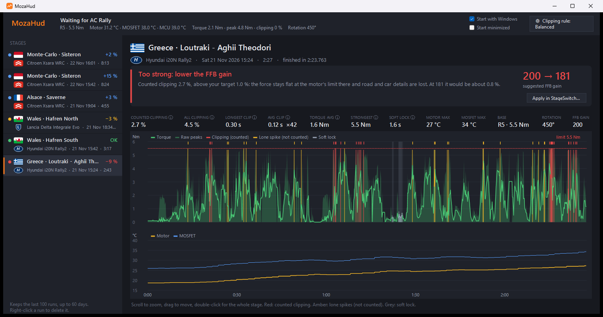
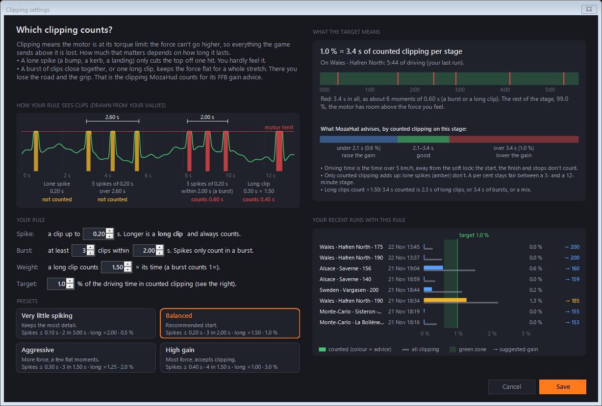
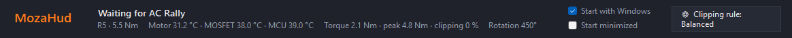
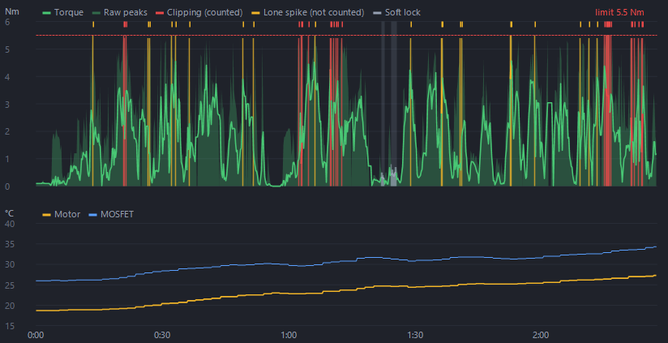
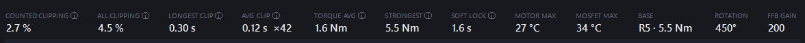
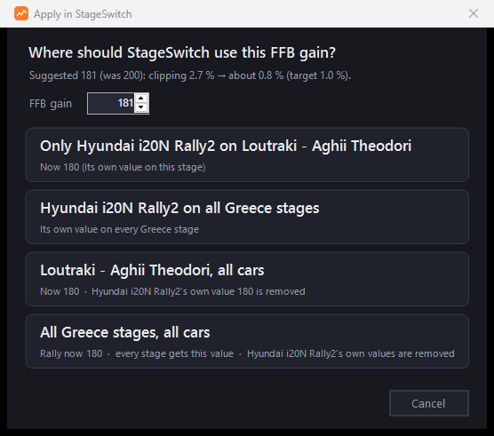

# MozaHud

**See what your MOZA wheelbase is really doing — and find the FFB gain that fits every stage.**

MozaHud reads your MOZA wheelbase while you drive Assetto Corsa Rally: how hard the motor pushes, when it runs out of
strength, and how warm it gets. After every stage it tells you, in plain words, whether your force feedback is too
strong, just right, or has room to spare — and it can show the same live numbers in your in-game overlay through
MSI Afterburner / RivaTuner.

> **A hobby project.** I built MozaHud in my spare time because I wanted to know what my own wheelbase was doing.
> I'm not affiliated with MOZA Racing, the makers of Assetto Corsa Rally, MSI, RivaTuner or anyone else, and I'm not
> paid or sponsored by anyone. See [Disclaimer](#disclaimer).

---

## Why you'd want this

Every wheelbase has a maximum force. Turn the FFB gain up too far and the motor hits that ceiling in the heavy
moments: a fast compression, a long hairpin, a big landing. While it sits at the ceiling the force stays **flat** —
the little kicks from the road and the feel for grip are gone, exactly when you need them. That is **clipping**.

Turn the gain down too far and you leave strength unused, and the car feels numb.

The sweet spot differs per stage and per car: tight tarmac in Monte-Carlo loads the wheel very differently from fast
gravel in Wales. You can't feel clipping reliably from the seat, and most bases don't tell you. MozaHud measures it
for every stage you drive and gives you a number to set.

## What you get

### Every stage recorded, automatically

Start a stage in AC Rally and MozaHud starts recording; cross the finish and it stops — no buttons. Each run gets the
rally's flag, the car's logo, the date and your stage time. The last 100 runs are kept.

### A clear verdict after each stage

Red means the motor was at its limit too often and you should lower the gain — MozaHud suggests the exact value.

Green means you're good. Blue means the opposite of red: the motor hardly reached its limit, so you're leaving feel on
the table, and MozaHud suggests a higher gain. It works out the exact value (in steps of 1) from the torque of that
run, so the next run lands just under your target.

Not every clip counts. A lone spike on a kerb or bump only cuts the top off one hit, and you hardly feel it. Many clips
close together, or one long clip, keep the force flat for a whole stretch, and that's where you lose the road. So
MozaHud counts **long clips** (by default longer than 0.20 s) and **bursts** of spikes (at least 3 clips within
2.00 s), with a target of 1 % of the driving time (green from 0.6 % up to it). On a 6-minute stage, 1 % is 3.6 s
of counted clipping in all: about a dozen short flat moments spread over the stage. In the graph, counted clipping is
red and lone spikes are amber.

The rule is up to you: the **Clipping rule** button (top right) opens the settings. You set the spike length, the
burst, how much heavier a long clip counts than a burst, and the target, or pick a preset: *Very little spiking*, *Balanced* (the default), *Aggressive* or *High gain*.
A picture drawn from your values shows what counts, another shows what the target means in seconds on your last
stage, and your recent runs are judged live while you change it.

### See exactly where it clipped

The torque graph shows the force on your wheel over the whole stage. Every moment the motor hit its limit gets a
**red bar** — so you can see whether it's a few bumps or the whole hairpin section. Scroll to zoom in, hover for the
details of that moment.

Turning the wheel all the way to its end (the **soft lock**) also makes the motor push at full force — that's not
your FFB clipping, so MozaHud shows it in **grey** and leaves it out of the verdict. It knows your base's rotation
(e.g. 450°) by asking the base itself.

### The numbers that matter

Clipping share, the **longest** clipping moment, the **average** length and how many there were, average and
strongest force, soft-lock time and temperatures. Hover over any ⓘ for an explanation.

Example from the stages above: at gain 150 the R5 clipped 5.4 % of the time, 49 times, the longest for half a second.
At 135 that dropped to 2.3 %, 21 short taps of about 0.14 s — the force detail was back, and the verdict turned green.

### Motor temperatures

The bottom graph shows how warm the motor and its driver electronics get over a stage, so you can spot a base that's
working hard.

### One click to save it in StageSwitch

If you use **[AC Rally StageSwitch](https://github.com/fbenniks/acr-mods-stageswitch)** (the companion app that sets the FFB gain per
stage automatically), MozaHud can send it the suggested gain. You choose where it applies: just this car on this
stage, this car on the whole rally, this stage for every car, or the whole rally for every car. Next time you load
that stage, it's set.

### Live in your in-game overlay (MSI Afterburner / RivaTuner)

Already using **MSI Afterburner** with **RivaTuner Statistics Server (RTSS)** to show FPS and temperatures in game?
MozaHud adds your wheelbase to it, in any game — not just AC Rally:

| In the overlay | What it shows |
|---|---|
| MOZA motor temp, MOSFET temp, MCU temp | How warm the base is (°C) |
| MOZA torque avg | The force on the wheel right now (Nm) |
| MOZA torque peak | The strongest force in the last second (Nm) |
| MOZA FFB load | That peak as % of what the base can do — 100 % means it's at the limit |
| MOZA clipping | How much of the last second it was at the limit (%) |

You place and style them like any other Afterburner value: graph, number, colour, alarm.
<!-- Overlay screenshot: save an in-game screenshot as docs/images/overlay-ingame.png and add:
 -->

### Works with every MOZA base

MozaHud asks the connected base what it is (R3, R5, R9, R12, R16, R21, R25, R27 and their Pro/Ultra versions) and
uses its real torque limit and rotation. Tested on an R5; the others are recognised the same way Pit House does it.

---

## Getting started

**You need:** Windows 10 or 11, a MOZA wheelbase on USB, and Assetto Corsa Rally for the stage recording.
Optional: AC Rally StageSwitch, and MSI Afterburner with RivaTuner for the overlay.

1. **Download** [`MozaHud.exe`](MozaHud.exe) and put it in a folder of its own. It's a single file; no installer.
   Windows may warn that it's from an unknown publisher (it isn't signed) — choose *More info → Run anyway*.
2. **Run it.** The MozaHud window opens and an icon appears in the system tray showing your motor temperature.
3. **Drive a stage.** That's it — the stage shows up in the list when you cross the finish.
4. Optional: tick **Start with Windows** and/or **Start minimized** (top right of the window, or right-click the
   tray icon). Start minimized opens MozaHud in the tray only, so it doesn't pop up when Windows starts.

Closing the window keeps MozaHud running in the tray; double-click the tray icon to open it again.

### Setting up the overlay (once)

1. Right-click the MozaHud tray icon → **Set up Afterburner…** and allow the admin prompt (Afterburner lives in
   Program Files).
2. Restart MSI Afterburner.
3. Afterburner → **Settings → Monitoring**: click the **…** button next to *Active hardware monitoring graphs* and
   tick **AIDA64.dll**.
4. Scroll to the bottom of the graph list, tick the MOZA values you want, select one and tick
   **Show in On-Screen Display**.
5. Tip: set **Hardware polling period** (same page) to **250 ms** — the default of one second makes the force values
   feel slow.

**Remove Afterburner setup…** in the tray menu undoes it.

## Good to know

- **Moza Pit House:** Windows lets only one program at a time talk to the base. While MozaHud runs, Pit House can't
  connect — right-click the tray icon → **Release COM port (for Pit House)** when you want to change settings there,
  and untick it afterwards.
- **Is it safe for my base?** MozaHud only *reads* from the base — the same questions Pit House asks when it
  connects. It never changes a setting on the base or flashes anything.
- **Other games?** The overlay works in every game. Stage recording and the advice are for AC Rally.
- **Bigger base?** For an R9 and up, raise the torque graphs' limit in Afterburner (*Graph limits*) — it starts at 6 Nm.
- **AIDA64:** MozaHud uses the same channel as AIDA64 to talk to Afterburner, so don't run AIDA64 at the same time.
- **Your data stays on your PC.** Runs are stored in `%APPDATA%\MozaHud\stages`; nothing is sent anywhere.

## How it works

Curious about the protocol, how a finish line is detected, or how the advice is calculated? See
[docs/HOW-IT-WORKS.md](docs/HOW-IT-WORKS.md).

## Credits

The MOZA serial protocol was reverse-engineered by the [boxflat](https://github.com/Lawstorant/boxflat) project (the
Linux MOZA control panel); MozaHud builds on that work.

## Disclaimer

MozaHud is a personal hobby project, made by one sim-rally fan in their spare time, for fun and for other fans.

- I am **not affiliated with, sponsored by, endorsed by or working for** MOZA Racing, the makers or publishers of
  Assetto Corsa Rally, MSI (Afterburner), the RivaTuner authors, FinalWire (AIDA64), or any other company or party.
  Nobody pays me for this, and none of them have reviewed or approved it.
- It is an **unofficial** tool. Everything it knows about the wheelbase comes from public reverse-engineering work
  and from observing what the base and the game report.
- It's provided **as is, without any warranty**. It only reads from your base and never changes its settings, but
  you use it at your own risk.
- All product names, logos and brands mentioned belong to their respective owners and are used only to describe
  what MozaHud works with.
