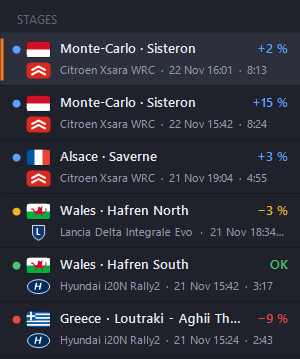
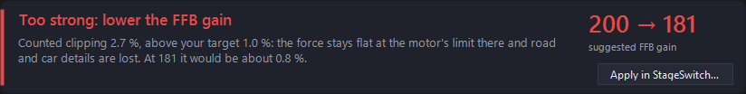
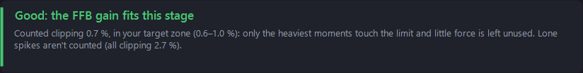
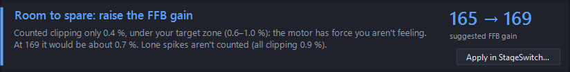
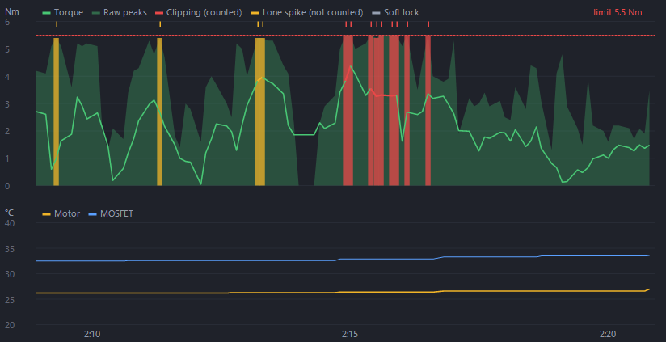

# MozaHud

**See what your MOZA wheelbase is really doing — and find the FFB gain that fits every stage.**

MozaHud reads your MOZA wheelbase while you drive Assetto Corsa Rally: how hard the motor pushes, when it runs out of
strength, and how warm it gets. After every stage it tells you, in plain words, whether your force feedback is too
strong, just right, or has room to spare — and it can show the same live numbers in your in-game overlay through
MSI Afterburner / RivaTuner.

> **A hobby project.** I built MozaHud in my spare time because I wanted to know what my own wheelbase was doing.
> I'm not affiliated with MOZA Racing, the makers of Assetto Corsa Rally, MSI, RivaTuner or anyone else, and I'm not
> paid or sponsored by anyone. See [Disclaimer](#disclaimer).

---

## Why you'd want this

Every wheelbase has a maximum force. Turn the FFB gain up too far and the motor hits that ceiling in the heavy
moments: a fast compression, a long hairpin, a big landing. While it sits at the ceiling the force stays **flat** —
the little kicks from the road and the feel for grip are gone, exactly when you need them. That is **clipping**.

Turn the gain down too far and you leave strength unused, and the car feels numb.

The sweet spot differs per stage and per car: tight tarmac in Monte-Carlo loads the wheel very differently from fast
gravel in Wales. You can't feel clipping reliably from the seat, and most bases don't tell you. MozaHud measures it
for every stage you drive and gives you a number to set.

## What you get

### Every stage recorded, automatically

Start a stage in AC Rally and MozaHud starts recording automatically. Each saved run shows the rally's flag,
the car's logo, the date and your stage time. MozaHud keeps up to 100 runs for up to 60 days.

### A clear verdict after each stage

MozaHud compares **counted clipping** with your target. With the default **Balanced** rule, the green zone is
**0.6–1.0%** of driving time. The analysis uses time at 5 km/h and above, with time at the wheel's rotation limit excluded.

**Red or amber advice** means counted clipping is above target. On Loutraki – Aghii Theodori, the run at gain
**200** had **2.7%** counted clipping. MozaHud suggests **181**, with an estimated **0.8%**.

**Green advice** means you can keep the gain. On Hafren South, **0.7%** counted clipping falls in the Balanced
zone even though all clipping totals **2.7%**.

**Blue advice** means there's room for more force. On Sisteron, **0.4%** counted clipping leaves room to go from
**165** to **169**. MozaHud needs at least a minute of driving to suggest a higher gain. It recommends changes
in whole gain points and estimates their effect from the recorded torque.

### Choose which clipping counts

Click **Clipping rule** at the top right. Choose **Very little spiking**, **Balanced** (the default),
**Aggressive** or **High gain**, or set your own spike length, burst size and window, long-clip weight and target.

With **Balanced**:

- A clip up to **0.20 s** is a spike. It counts only if it's part of a burst of **at least 3 clips within
  2.00 s**, measured from the start of the first clip to the end of the last.
- A longer clip always counts at **1.5×** its duration. For example, a **0.30 s** clip adds **0.45 s** to the
  counted total. Spikes in a burst count at their actual duration.
- The target is **1.0%** of driving time. On the **6:26** of driving shown below, that's about **3.9 s** of
  counted clipping after applying the long-clip weight.

As you edit the rule, the dialog redraws the example, translates the target into seconds for your latest run
and previews how the rule would judge your recent runs. Click **Save** to apply it.

### See exactly where it clipped

The torque graph shows the force on your wheel over the whole stage. **Green** is normal torque, **red** is
clipping that counts toward the verdict, and **amber** marks isolated spikes that the rule leaves out. Scroll
to zoom, drag to move along the timeline, double-click to reset the view, and hover for details.

The **soft lock** is where the motor pushes back when you turn the wheel to its rotation limit. MozaHud reads
that limit from the base, shows soft lock in **grey**, and leaves it out of the verdict.

### The numbers that matter

**Counted clipping** drives the gain advice. **All clipping** shows the actual share of driving time spent at
the limit, including isolated spikes. The tiles also show the longest clip, average clip length and number of
clips, torque, soft-lock time, temperatures and gain.

New recordings keep the individual torque readings, so MozaHud measures clip lengths to about **0.03 s**.
Older recordings use the current clipping rule with their original **0.1 s** peak readings. If a recording
repeatedly exceeded its saved torque limit, MozaHud uses the highest peak outside soft lock as its limit.

### Motor temperatures

The bottom graph shows how warm the motor and its driver electronics get over a stage, so you can spot a base that's
working hard.

### One click to save it in StageSwitch

Keep both apps open, select a run with a suggested gain, and click **Apply in StageSwitch…**. You can adjust
the value in the dialog and save it for this car on this stage, this car across the rally, the stage default,
or every stage default in the rally. StageSwitch uses the saved gain when you load a matching stage. It can also
apply it while you're on that stage. [AC Rally StageSwitch](https://github.com/fbenniks/acr-mods-stageswitch)

### Live in your in-game overlay (MSI Afterburner / RivaTuner)

Already using **MSI Afterburner** with **RivaTuner Statistics Server (RTSS)** to show FPS and temperatures in game?
MozaHud adds your wheelbase to it, in any game — not just AC Rally:

| In the overlay | What it shows |
|---|---|
| MOZA motor temp, MOSFET temp, MCU temp | How warm the base is (°C) |
| MOZA torque avg | The force on the wheel right now (Nm) |
| MOZA torque peak | The strongest force in the last second (Nm) |
| MOZA FFB load | That peak as % of what the base can do — 100 % means it's at the limit |
| MOZA clipping | How much of the last second the motor was at the limit (%) |

The clipping rule is for stage advice. The live overlay reports clipping over the last second. You can place
and style the readings like any other Afterburner value: graph, number, colour, alarm.
<!-- Overlay screenshot: save an in-game screenshot as docs/images/overlay-ingame.png and add:
 -->

### Works with every MOZA base

MozaHud asks the connected base what it is (R3, R5, R9, R12, R16, R21, R25, R27 and their Pro/Ultra versions) and
uses its real torque limit and rotation. Tested on an R5; the others are recognised the same way Pit House does it.

---

## Getting started

**You need:** Windows 10 or 11, a MOZA wheelbase on USB, and Assetto Corsa Rally for the stage recording.
Optional: AC Rally StageSwitch, and MSI Afterburner with RivaTuner for the overlay.

1. **Download** [`MozaHud.exe`](MozaHud.exe) and put it in a folder of its own. It's a single file; no installer.
   Windows may warn that it's from an unknown publisher (it isn't signed) — choose *More info → Run anyway*.
2. **Run it.** The MozaHud window opens and an icon appears in the system tray showing your motor temperature.
3. **Drive a stage.** That's it — the stage shows up in the list when you cross the finish.
4. Optional: tick **Start with Windows** and/or **Start minimized** (top right of the window, or right-click the
   tray icon). Start minimized opens MozaHud in the tray only, so it doesn't pop up when Windows starts.

Closing the window keeps MozaHud running in the tray; double-click the tray icon to open it again.

### Setting up the overlay (once)

1. Right-click the MozaHud tray icon → **Set up Afterburner…** and allow the admin prompt (Afterburner lives in
   Program Files).
2. Restart MSI Afterburner.
3. Afterburner → **Settings → Monitoring**: click the **…** button next to *Active hardware monitoring graphs* and
   tick **AIDA64.dll**.
4. Scroll to the bottom of the graph list, tick the MOZA values you want, select one and tick
   **Show in On-Screen Display**.
5. Tip: set **Hardware polling period** (same page) to **250 ms** — the default of one second makes the force values
   feel slow.

**Remove Afterburner setup…** in the tray menu undoes it.

## Good to know

- **Moza Pit House:** Windows lets only one program at a time talk to the base. While MozaHud runs, Pit House can't
  connect — right-click the tray icon → **Release COM port (for Pit House)** when you want to change settings there,
  and untick it afterwards.
- **Is it safe for my base?** MozaHud only *reads* from the base — the same questions Pit House asks when it
  connects. It never changes a setting on the base or flashes anything.
- **Other games?** The overlay works in every game. Stage recording and the advice are for AC Rally.
- **Bigger base?** For an R9 and up, raise the torque graphs' limit in Afterburner (*Graph limits*) — it starts at 6 Nm.
- **AIDA64:** MozaHud uses the same channel as AIDA64 to talk to Afterburner, so don't run AIDA64 at the same time.
- **Your data stays on your PC.** Runs are stored in `%APPDATA%\MozaHud\stages`; nothing is sent anywhere.

## How it works

Curious about the protocol, how a finish line is detected, or how the advice is calculated? See
[docs/HOW-IT-WORKS.md](docs/HOW-IT-WORKS.md).

## Credits

The MOZA serial protocol was reverse-engineered by the [boxflat](https://github.com/Lawstorant/boxflat) project (the
Linux MOZA control panel); MozaHud builds on that work.

## Disclaimer

MozaHud is a personal hobby project, made by one sim-rally fan in their spare time, for fun and for other fans.

- I am **not affiliated with, sponsored by, endorsed by or working for** MOZA Racing, the makers or publishers of
  Assetto Corsa Rally, MSI (Afterburner), the RivaTuner authors, FinalWire (AIDA64), or any other company or party.
  Nobody pays me for this, and none of them have reviewed or approved it.
- It is an **unofficial** tool. Everything it knows about the wheelbase comes from public reverse-engineering work
  and from observing what the base and the game report.
- It's provided **as is, without any warranty**. It only reads from your base and never changes its settings, but
  you use it at your own risk.
- All product names, logos and brands mentioned belong to their respective owners and are used only to describe
  what MozaHud works with.
